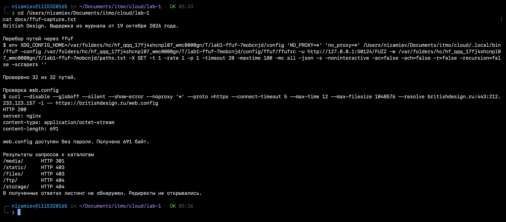
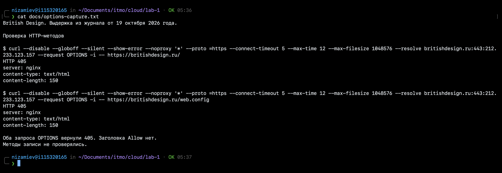

# Отчёт по лабораторной 1 с nginx

Код находится в [репозитории](https://github.com/vergjs/cloud-technologies), порядок запуска описан в [README.md](README.md), требования приведены в [задании](https://docs.google.com/document/d/19LNpEpXeLxTAPDgKczQPlA44Lc7e9Tgt/edit).

## Стенд

nginx принимает запросы к сервису задач из лабы 0, отдаёт HTML/CSS/JS и распределяет обращения к `/api` между двумя экземплярами Flask, которые подключены к одной PostgreSQL и видят одинаковые задачи.

Стенд проверен 18 октября 2026 года на macOS ARM64 с nginx 1.30.6, OpenSSL 3.6.4, Python 3.12 и PostgreSQL 16.15, повторные проверки и снимки терминала и Safari сделаны 19 октября. nginx и бэкенды доступны только на loopback, где Flask слушает порты 8000 и 8001.

Функциональные проверки выполнены на обязательных по ТЗ портах **HTTP 80 и HTTPS 443**, запросы направлялись на локальный стенд с проверкой сертификата.

На главной странице показана сохранённая задача, внизу указан ответивший экземпляр `backend-1`.


## Настройка nginx

Полный конфиг находится в [nginx/nginx.conf.template](nginx/nginx.conf.template), где [setup.sh](scripts/setup.sh) заменяет параметры `@...@` путями, портами, именем пользователя и его основной группы. Этот же скрипт создаёт сертификат и `htpasswd`, которые вместе с закрытым ключом, `.env` и рабочим каталогом `.run/` исключены из Git.

### HTTPS и разделение фронтенда и API

```nginx
ssl_certificate "@LAB_DIR@/.run/tls/server.crt";
ssl_certificate_key "@LAB_DIR@/.run/tls/server.key";
ssl_protocols TLSv1.2 TLSv1.3;

server {
    listen 127.0.0.1:@HTTP_PORT@;
    server_name todo.localhost other.localhost;
    return 301 https://$host@HTTPS_SUFFIX@$request_uri;
}
```

HTTP перенаправляет оба известных домена на HTTPS с сохранением пути и параметров запроса, при этом `@HTTPS_SUFFIX@` пуст при используемом порте 443. При работе с самоподписанным сертификатом, содержащим SAN для `todo.localhost` и `other.localhost`, curl проверяет его через `--cacert` и направляет запросы на `127.0.0.1` через `--resolve` без отключения проверки TLS.

В HTTPS-сервере `todo.localhost` настроена раздельная обработка статики и API.

```nginx
root "@REPO_DIR@/lab-0/frontend";

location ^~ /api/ {
    limit_req zone=api_per_ip burst=10 nodelay;
    proxy_pass http://todo_backends;
}

location / {
    try_files $uri $uri/ =404;
}
```

nginx читает статические файлы из `lab-0/frontend/` и передаёт `/api/tasks` во Flask с сохранением `/api`, поскольку у `proxy_pass` не указан URI после имени upstream. Для точного пути `/api` настроен отдельный `location = /api` с теми же параметрами.

### Балансировка и отказ одного бэкенда

```nginx
upstream todo_backends {
    server 127.0.0.1:@BACKEND1_PORT@ max_fails=1 fail_timeout=5s;
    server 127.0.0.1:@BACKEND2_PORT@ max_fails=1 fail_timeout=5s;
}
```

Балансировка работает по методу round robin, ответивший процесс указан в заголовке `X-Instance-Id` и поле `instance_id` JSON. В блоке `server` заданы таймауты и условия перехода на другой бэкенд.

```nginx
proxy_connect_timeout 1s;
proxy_read_timeout 5s;
proxy_send_timeout 5s;
proxy_next_upstream error timeout http_502 http_503 http_504;
proxy_next_upstream_tries 2;
```

После одной учитываемой ошибки nginx исключает бэкенд на пять секунд и при ошибке соединения может направить запрос второму экземпляру в пределах заданных таймаутов. Повтор неидемпотентного запроса после отправки бэкенду отключён, чтобы POST не создал запись дважды.

### Отдельные каталоги и Basic Auth

```nginx
location = /docs {
    return 301 /docs/;
}
location /docs/ {
    alias "@LAB_DIR@/static/docs/";
}

location = /admin {
    auth_basic "Lab 1 admin";
    auth_basic_user_file "@LAB_DIR@/.run/htpasswd";
    default_type text/html;
    alias "@LAB_DIR@/static/admin/index.html";
}
```

`alias` заменяет префикс `/docs/` путём к отдельной папке, причём завершающий `/` у `location` и каталога исключает совпадение с путями вида `/docs../...`.

Страница помощи открывается из отдельного каталога через `/docs/`.


`/admin`, `/admin/` и вложенные пути отдают файлы после проверки Basic Auth. Директива `return 200` здесь завершила бы запрос до фазы проверки доступа, поэтому используется отдача файла через `alias`. Пароль вводится локально при подготовке стенда и хранится вне конфигурации и проверочного скрипта.

При открытии `/admin` Safari запрашивает имя пользователя и пароль, успешный вход с ответом `200` подтверждён отдельным запросом curl, который приведён ниже.


### Домены, ограничение запросов и своя 404

Неизвестные домены обрабатывает сервер по умолчанию со следующими директивами.

```nginx
listen 127.0.0.1:@HTTP_PORT@ default_server;
listen 127.0.0.1:@HTTPS_PORT@ ssl default_server;
server_name _;

location / {
    return 404;
}
```

Сервер `todo.localhost` обслуживает основной сайт, `other.localhost` отдаёт файлы из `static/other/` без доступа к API первого проекта, неизвестный Host получает 404.

На `other.localhost` открывается отдельный сайт с материалами команды.


Ограничение частоты запросов задано в контексте `http`.

```nginx
limit_req_zone $binary_remote_addr zone=api_per_ip:10m rate=5r/s;
limit_req_status 429;
```

В API-location директива `limit_req zone=api_per_ip burst=10 nodelay` ограничивает среднюю частоту до 5 запросов/с с IP, допускает кратковременный избыток в пределах burst без задержки и возвращает 429 при превышении лимита.

Своя страница ошибки подключена в каждом виртуальном хосте.

```nginx
error_page 404 /404.html;
location = /404.html {
    internal;
    alias "@LAB_DIR@/static/errors/404.html";
}
```

Директива `internal` разрешает только внутренние перенаправления в этот location, через который nginx возвращает собственную HTML-страницу со статусом 404.

Для отсутствующей страницы отображается собственная страница ошибки.


## Результаты обычной части

Проверки выполнены через [check.sh](check.sh) на портах 80/443. Ниже приведена выдержка из вывода от 18 октября с итогами каждого пункта, команды и ответы повторного запуска показаны на снимках терминала.

```text
Лаба 1: проверка nginx (2026-10-18 18:53:48 UTC)
TLS проверяется по локальному сертификату; curl без -k.
Порты этого прогона: HTTP=80, HTTPS=443. По ТЗ: 80/443.

PASS: HTTP перенаправляется на HTTPS (301)
PASS: TLS доверен; nginx сам отдаёт фронтенд
PASS: alias /docs/ отдаёт отдельный каталог
PASS: виртуальные хосты изолированы; неизвестный Host получает 404
PASS: /admin без пароля возвращает 401 и WWW-Authenticate
SKIP: вход с паролем (задайте LAB1_ADMIN_PASSWORD); защита без пароля проверена
PASS: несуществующая страница возвращает свою 404
PASS: балансировка: backend-1=4, backend-2=4
PASS: после остановки backend-1 API и фронтенд доступны
PASS: limit_req ограничивает частоту ответами 429
PASS: функциональные проверки выполнены на HTTP=80/HTTPS=443; backend-1 восстановлен
```

Вход с паролем проверен отдельно 18 октября, пароль вводился по приглашению curl.

```bash
curl --disable --noproxy '*' --cacert .run/tls/server.crt \
  --resolve todo.localhost:443:127.0.0.1 \
  --user admin --head --fail --silent --show-error https://todo.localhost/admin
```

```http
HTTP/1.1 200 OK
Server: nginx/1.30.6
Date: Sun, 18 Oct 2026 19:13:20 GMT
Content-Type: text/html; charset=utf-8
Content-Length: 4178
Last-Modified: Sun, 18 Oct 2026 18:25:23 GMT
Connection: keep-alive
ETag: "6ad50f13-1052"
Accept-Ranges: bytes
```

На снимке терминала показаны успешная проверка конфигурации, редирект `301` на HTTPS, чередование двух бэкендов и `401` при обращении к `/admin` без пароля.


| Проверка | Результат на 80/443 |
|---|---|
| HTTP → HTTPS | `301`, `Location: https://todo.localhost/` |
| TLS и статика | сертификат проверен, `/` → `200`, заголовка бэкенда нет |
| `alias /docs/` | `200`, содержимое отдельного каталога |
| Виртуальные хосты | второй сайт → `200`, его `/api/tasks` и неизвестный Host → `404` |
| Basic Auth | без пароля → `401`, с правильным паролем → `200` |
| Своя 404 | неизвестная страница → `404`, в HTML есть маркер `lab1-not-found` |
| Балансировка | 8 запросов дали по 4 ответа от `backend-1` и `backend-2` |
| Отказ бэкенда | после остановки `backend-1` пять GET подряд → `200` от `backend-2`, фронтенд → `200` |
| Запись при отказе | отдельный POST → `201` от `backend-2`, следующий GET → `200` и содержит созданную задачу |
| Восстановление | `backend-1` снова запущен, `/health` → `200` |
| Ограничение частоты | из 40 запросов получены 11 ответов `200` и 29 ответов `429` |
| Общая БД | POST через HTTPS → `201`, шесть GET прочитали созданную задачу через оба экземпляра, тестовая запись удалена |

Во время проверки отказа `check.sh` останавливает процесс через `backend.sh` и восстанавливает его после завершения или через `trap` при прерывании. Проверка охватывает остановку одного Flask-процесса при работающих nginx и PostgreSQL.

На снимке после остановки первого бэкенда три запроса получают `200` от второго, затем первый запускается с ответом `/health` `200`. Проверка ограничения частоты даёт 11 ответов `200` и 29 ответов `429` на 40 запросов.


## Проверка British Design для задания со звёздочкой

19 октября выполнены проверки с помощью ffuf 2.1.0 и curl. Ниже приведены команды и ответы из сохранённого прогона, переносы строк добавлены для чтения. Использовались GET, HEAD и OPTIONS с интервалом не меньше секунды и проверкой TLS. Скриншоты терминала показывают сохранённые выдержки этого прогона.

### Проверка сервера British Design

Для подробного разбора выбран `britishdesign.ru`. Запрос HEAD к главной вернул `200` и заголовок `Server: nginx`.

```bash
curl --disable --globoff --silent --show-error --noproxy '*' --proto =https \
  --connect-timeout 5 --max-time 12 --max-filesize 1048576 \
  --resolve britishdesign.ru:443:212.233.123.157 \
  --head -i -- https://britishdesign.ru/
```

Перед перебором получен контрольный ответ на случайный отсутствующий путь, чтобы сравнивать с ним найденные страницы.

```bash
curl --disable --globoff --silent --show-error --noproxy '*' --proto =https \
  --connect-timeout 5 --max-time 12 --max-filesize 1048576 \
  --resolve britishdesign.ru:443:212.233.123.157 \
  -i -- https://britishdesign.ru/lab1-not-found-ebed3272a3d1091d
```

Контрольный запрос получил `301` с пустым телом, переход по редиректу не выполнялся.

### Поиск служебных файлов через ffuf

Проверялось, доступны ли по обычному HTTP-запросу конфигурации и служебные разделы. Использован фиксированный словарь из 32 путей, в том числе `admin/`, `config/`, `web.config`, `media/`, `static/`, `ftp/` и `storage/`.

Во время прогона ffuf обращался к временному локальному адаптеру на порту 50124, который передавал запросы на `britishdesign.ru` через curl. Адаптер проверял TLS и выдерживал интервал между запросами. Ниже путь к временной папке вынесен в `FFUF_TMP`, параметры соответствуют записанному запуску.

```bash
FFUF_TMP=/var/folders/hc/hf_qqq_17fj4shcnpl07_wmc0000gn/T/lab1-ffuf-7mobcnjd
env XDG_CONFIG_HOME="$FFUF_TMP/config" NO_PROXY='*' no_proxy='*' \
  /Users/nizamiev/Documents/itmo/cloud/.local/bin/ffuf \
  -config "$FFUF_TMP/config/ffuf/ffufrc" \
  -u http://127.0.0.1:50124/FUZZ -w "$FFUF_TMP/paths.txt" \
  -X GET -t 1 -rate 1 -p 1 -timeout 20 -maxtime 180 -mc all \
  -json -s -noninteractive -ac=false -ach=false -r=false \
  -recursion=false -scrapers ''
```

`FUZZ` заменялся строками словаря, `-t 1` оставлял один поток, `-rate 1` и `-p 1` ограничивали частоту. Параметр `-mc all` сохранял все статусы, рекурсия и переходы по редиректам были отключены. Это запись завершённого запуска, временный адаптер и его файлы после прогона удалены.

Получены ответы на все 32 пути. Для `/web.config` адаптер выполнил следующую команду.

```bash
curl --disable --globoff --silent --show-error --noproxy '*' --proto =https \
  --connect-timeout 5 --max-time 12 --max-filesize 1048576 \
  --resolve britishdesign.ru:443:212.233.123.157 \
  -i -- https://britishdesign.ru/web.config
```

В журнале сохранены следующие поля ответа.

```text
HTTP 200
server: nginx
content-type: application/octet-stream
content-length: 691
Получено байт  691
```

Проверялась утечка служебной конфигурации, при которой посетитель получает закрытые настройки, внутренние пути или учётные данные приложения. Такие сведения могут помочь получить доступ к другим компонентам, поэтому доступность и содержимое конфигурационных файлов рассматриваются в [OWASP WSTG-CONF-04](https://wstg.owasp.org/v4.2/4-Web_Application_Security_Testing/02-Configuration_and_Deployment_Management_Testing/04-Review_Old_Backup_and_Unreferenced_Files_for_Sensitive_Information/).

В нашем случае подтверждено получение `web.config` без авторизации. Повторный разбор дал те же размер и SHA256, активный XML содержал только `configuration` и пустой `system.webServer`, остальные настройки находились в комментарии. Признаков паролей, токенов и строк подключения при анализе не обнаружено.

Файл отмечен как информационная находка, поскольку утечка чувствительных данных, непредусмотренность публикации и возможность эксплуатации не установлены. Сам факт выдачи файла не подтверждает уязвимость nginx.

### Проверка листинга каталогов

При включённом листинге сервер может раскрывать список файлов каталога. Проверка выполнялась по ответам того же перебора, дополнительных запросов для анализа не отправлялось. Например, для `/static/` выполнялась команда

```bash
curl --disable --globoff --silent --show-error --noproxy '*' --proto =https \
  --connect-timeout 5 --max-time 12 --max-filesize 1048576 \
  --resolve britishdesign.ru:443:212.233.123.157 \
  -i -- https://britishdesign.ru/static/
```

Для ответов `200` анализировались HTML с заголовком `Index of /` и ссылками на файлы либо XML с корневым элементом `ListBucketResult`, характерным для S3/MinIO. В завершённых ответах этих признаков не получено.

| Путь | HTTP | Наблюдение |
|---|---|---|
| `/media/` | `301` | редирект, конечное содержимое не проверялось |
| `/static/` | `403` | доступ запрещён |
| `/files/` | `403` | доступ запрещён |
| `/ftp/` | `404` | путь не найден |
| `/storage/` | `404` | путь не найден |

На снимке показаны команда ffuf, завершение перебора 32 путей, ответ на запрос `/web.config` и статусы каталогов.



### Проверка объявленных HTTP-методов

OPTIONS использован для предварительной проверки объявленных методов главной страницы и найденного файла.

```bash
curl --disable --globoff --silent --show-error --noproxy '*' --proto =https \
  --connect-timeout 5 --max-time 12 --max-filesize 1048576 \
  --resolve britishdesign.ru:443:212.233.123.157 \
  --request OPTIONS -i -- https://britishdesign.ru/

curl --disable --globoff --silent --show-error --noproxy '*' --proto =https \
  --connect-timeout 5 --max-time 12 --max-filesize 1048576 \
  --resolve britishdesign.ru:443:212.233.123.157 \
  --request OPTIONS -i -- https://britishdesign.ru/web.config
```

В обоих случаях получен `405`, заголовок `Allow` отсутствовал. Такой ответ не доказывает ни разрешение, ни запрет записи. POST, PUT и DELETE не отправлялись, возможность изменения файла не установлена.



### Итог проверки

Для British Design выполнено 37 запросов, включая все 32 пути словаря. Успешный взлом не подтверждён, доступный `web.config` оставлен в отчёте как информационная находка.
