# Отчёт по лабораторной 2: Docker

Код находится в [репозитории](https://github.com/vergjs/cloud-technologies), порядок запуска описан в [README.md](README.md).

Всё проверено 5 ноября 2026 года на macOS 26.3 (Apple Silicon) в Docker Desktop 29.9.2 с Compose v5.6.1. Виртуальной машине Docker выделено 8 CPU и 8 ГБ памяти. Нагрузку давал `hey` 0.1.5 с хоста.

Скриншоты терминала в `docs/screenshots/` отрисованы утилитой [freeze](https://github.com/charmbracelet/freeze) из сохранённого вывода команд, текст в них не редактировался. Скриншот страницы снят в Chrome в headless-режиме.

## Стек

```text
браузер ──> frontend (nginx, :8080) ──/api, /health──> backend (gunicorn + Flask, :8000) ──> db (PostgreSQL 16, :5432)
            └──────── frontend-net ────────┘           └────────── backend-net (internal) ──────────┘
```

Бэкенд — код лабы 0 без изменений (`lab-0/backend/app.py`), в контейнере он запускается через gunicorn вместо dev-сервера Flask. Фронтенд вынесен в отдельный контейнер nginx: он отдаёт статику `lab-0/frontend/` и проксирует `/api/` и `/health` на `backend:8000`. Страница открыта через стек, внизу виден ответивший экземпляр `backend-docker`:

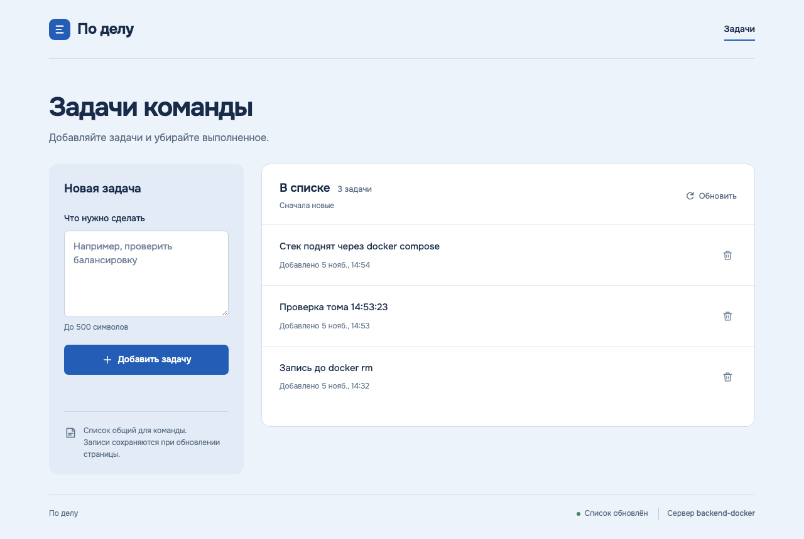

## Плохой и хороший образы бэкенда

Оба образа собираются из корня репозитория, потому что код лежит в `lab-0/`, а файлы Docker в `lab-2/`:

```bash
docker build -f lab-2/backend/Dockerfile.bad -t todo-backend:bad .
docker build -f lab-2/backend/Dockerfile -t todo-backend:good .
```

### Плохой Dockerfile

[backend/Dockerfile.bad](backend/Dockerfile.bad):

```dockerfile
# Намеренно плохой образ бэкенда. Не используйте его для запуска стека.
# Собирается из корня репозитория:
#   docker build -f lab-2/backend/Dockerfile.bad -t todo-backend:bad .

# 1. Плавающий тег и полный образ Python с компиляторами и документацией.
#    С python:latest (5 ноября 2026 это Python 3.15.2) образ уже не собирается:
#    psycopg2 2.9.10 не компилируется под новый C API, подробности в REPORT.md.
#    Тег 3.12 тоже плавающий: патч-версия и Debian под ним меняются без предупреждения.
FROM python:3.12

# 2. Пароль зашит в образ и виден через docker history и docker inspect
ENV DB_PASSWORD=supersecret123

# 3. Инструменты отладки и сборки, которые приложению не нужны,
#    отдельными слоями и без очистки списков пакетов apt
RUN apt-get update
RUN apt-get install -y vim curl gcc

# 4. Копируется весь контекст: .git, скриншоты, другие лабы и .env, если он есть.
#    Файла .dockerignore для этого образа нет.
# 5. Код копируется до установки зависимостей, поэтому любая правка
#    кода сбрасывает кеш слоя pip install
COPY . /app
WORKDIR /app/lab-0/backend
RUN pip install -r requirements.txt

# 6. Нет USER: процесс работает от root
# 7. Нет HEALTHCHECK, Docker не знает, жив ли сервис
# 8. Shell-форма CMD: PID 1 становится sh, SIGTERM до Python не доходит,
#    и docker stop по таймауту убивает контейнер через SIGKILL (код 137).
#    Запуск на dev-сервере Flask.
CMD python app.py
```

### Хороший Dockerfile

[backend/Dockerfile](backend/Dockerfile):

```dockerfile
# Хороший образ бэкенда. Собирается из корня репозитория:
#   docker build -f lab-2/backend/Dockerfile -t todo-backend:good .
# Список файлов контекста ограничен в Dockerfile.dockerignore рядом с этим файлом.

# Зафиксированная версия и slim-вариант базового образа
ARG PYTHON_IMAGE=python:3.12.16-slim-trixie

# Стадия сборки: зависимости ставятся в отдельное виртуальное окружение
FROM ${PYTHON_IMAGE} AS builder
ENV PIP_NO_CACHE_DIR=1 PIP_DISABLE_PIP_VERSION_CHECK=1
RUN python -m venv /opt/venv
# Сначала только списки зависимостей: слой ниже пересобирается
# только при их изменении, а не при правке кода
COPY lab-0/backend/requirements.txt requirements-app.txt
COPY lab-2/backend/requirements.txt requirements-docker.txt
RUN /opt/venv/bin/pip install -r requirements-app.txt -r requirements-docker.txt

# Итоговая стадия: только интерпретатор, окружение и код
FROM ${PYTHON_IMAGE}
ENV PYTHONDONTWRITEBYTECODE=1 \
    PYTHONUNBUFFERED=1 \
    PATH=/opt/venv/bin:$PATH \
    PORT=8000
# Отдельный системный пользователь без домашнего каталога и shell
RUN groupadd --system --gid 10001 app \
    && useradd --system --uid 10001 --gid app --no-create-home --shell /usr/sbin/nologin app
COPY --from=builder /opt/venv /opt/venv
WORKDIR /app
# Конфиг меняется редко, код чаще, поэтому код копируется последним.
# Файлы остаются во владении root: пользователь app может их только читать.
COPY lab-2/backend/gunicorn.conf.py ./
COPY lab-0/backend/app.py ./
USER app
EXPOSE 8000
HEALTHCHECK --interval=10s --timeout=3s --start-period=10s --retries=3 \
    CMD ["python", "-c", "import os, urllib.request; urllib.request.urlopen(f'http://127.0.0.1:{os.environ[\"PORT\"]}/health', timeout=2)"]
# Exec-форма: gunicorn сам получает SIGTERM и корректно завершает воркеры
CMD ["gunicorn", "--config", "gunicorn.conf.py", "app:app"]
```

[backend/Dockerfile.dockerignore](backend/Dockerfile.dockerignore):

```text
# Контекст сборки — корень репозитория. BuildKit берёт этот файл вместо
# корневого .dockerignore, потому что он называется <имя Dockerfile>.dockerignore.
# Исключаем всё и разрешаем только то, что копирует Dockerfile.
*
!lab-0/backend/app.py
!lab-0/backend/requirements.txt
!lab-2/backend/requirements.txt
!lab-2/backend/gunicorn.conf.py
```

Контекст сборки — корень репозитория, а класть `.dockerignore` в корень значило бы менять общий для всех лаб файл. BuildKit для Dockerfile с именем `X` сначала ищет рядом с ним `X.dockerignore` и только потом корневой `.dockerignore`, поэтому у хорошего образа свой список исключений. У `Dockerfile.bad` такого файла нет, и в его контекст попадает всё.

### Какие плохие практики были и как они исправлены

| № | Плохой образ | Чем это плохо | Как в хорошем |
|---|---|---|---|
| 1 | `FROM python:latest` (в итоге `python:3.12`) | Тег плавающий: образ меняется без изменения Dockerfile. Полный образ с компиляторами весит больше гигабайта | `python:3.12.16-slim-trixie`, точная версия и slim-вариант |
| 2 | `ENV DB_PASSWORD=supersecret123` | Пароль навсегда остаётся в слоях и виден через `docker history` | Пароль передаётся только при запуске из `.env` через compose |
| 3 | `RUN apt-get update` и `RUN apt-get install -y vim curl gcc` отдельными слоями | Лишние пакеты в образе, кеш apt остаётся. Отдельный `update` из кеша потом устаревает | Сборка не нужна: колёса psycopg2-binary и gunicorn уже собраны, в итоговой стадии нет ни компиляторов, ни редакторов |
| 4 | `COPY . /app` без `.dockerignore` | В образ попадают `.git`, скриншоты, другие лабы и локальный `.env` с паролем | Список разрешённых файлов в `Dockerfile.dockerignore`, `COPY` только нужных файлов |
| 5 | Код копируется до `pip install` | Любая правка кода сбрасывает кеш, и зависимости ставятся заново | Сначала копируются только `requirements*.txt` и ставятся зависимости, код — последним слоем |
| 6 | Нет `USER` | Процесс работает от root | Системный пользователь `app` (uid 10001) без shell и домашнего каталога, файлы кода принадлежат root и доступны только на чтение |
| 7 | Нет `HEALTHCHECK` | Docker не знает, жив ли сервис, на него нельзя завязать `depends_on` | `HEALTHCHECK` запрашивает `/health`, который делает `SELECT 1` в БД |
| 8 | Shell-форма `CMD python app.py` на dev-сервере Flask | PID 1 — `/bin/sh`, SIGTERM до Python не доходит, контейнер убивается SIGKILL | Exec-форма `CMD ["gunicorn", ...]`: gunicorn сам принимает SIGTERM и завершает воркеры |
| — | Одна стадия | Инструменты установки остаются в итоговом образе | Multi-stage: зависимости ставятся в стадии `builder` в `/opt/venv`, в итоговую стадию копируется только окружение |

Отдельно о п. 1. Сначала плохой образ был написан с `FROM python:latest`, и 5 ноября 2026 года он не собрался. Тег `latest` уже указывает на Python 3.15.2, для которого у `psycopg2-binary==2.9.10` нет готового колеса. pip начал собирать пакет из исходников и упал:

```text
$ docker run --rm python:latest python --version
Python 3.15.2

#10 13.46       psycopg/connection_int.c:1050:21: error: implicit declaration of function ‘PyWeakref_GetObject’; did you mean ‘PyWeakref_GetRef’? [-Wimplicit-function-declaration]
#10 13.46   ERROR: Failed building wheel for psycopg2-binary
```

Это и есть главный риск плавающего тега: тот же Dockerfile, который вчера собирался, сегодня ломается. Чтобы плохой образ всё же можно было измерить, тег заменён на `python:3.12`. Он тоже плавающий (патч-версия и Debian под ним меняются), но совместим с psycopg2 2.9.10.

### Размер, пользователь, содержимое

```text
$ docker images todo-backend
REPOSITORY     TAG       SIZE
todo-backend   bad       1.78GB
todo-backend   good      243MB

$ docker exec t-bad whoami
root
$ docker exec t-good whoami
app
$ docker exec t-good id
uid=10001(app) gid=10001(app) groups=10001(app)

$ docker exec t-bad ls -a /app
.
..
.git
.gitignore
README.md
lab-0
lab-1
lab-2
$ docker exec t-good ls -la /app
total 20
drwxr-xr-x 1 root root 4096 Nov  5 11:25 .
drwxr-xr-x 1 root root 4096 Nov  5 11:27 ..
-rw-r--r-- 1 root root 5657 Nov  5 10:50 app.py
-rw-r--r-- 1 root root  467 Nov  5 11:08 gunicorn.conf.py

$ docker history todo-backend:bad --format "{{.CreatedBy}}" | grep DB_PASSWORD
ENV DB_PASSWORD=supersecret123

$ docker exec t-good sh -c "command -v gcc curl vim pip; echo exit=\$?"
exit=127
$ docker exec t-bad sh -c "command -v gcc curl vim"
/usr/bin/gcc

$ time docker stop t-bad
t-bad
real 3.13
user 0.01
sys 0.01
$ time docker stop t-good
t-good
real 0.34
user 0.01
sys 0.01
```

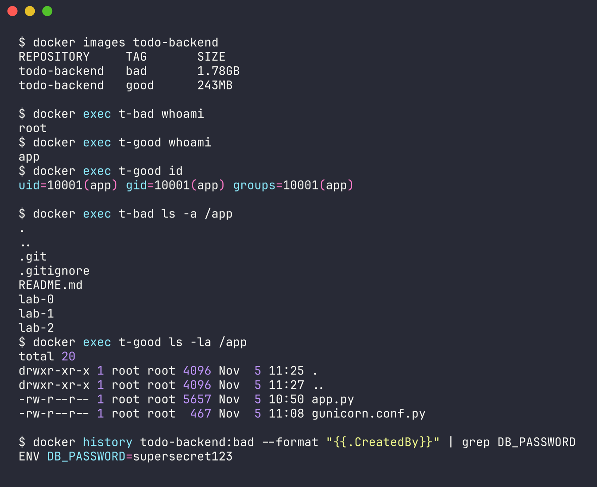

- **Размер.** Хороший образ занимает 243 МБ, плохой 1.78 ГБ, разница в 7.3 раза. Основной выигрыш дают slim-база вместо полного образа и отсутствие apt-пакетов, `.git` и скриншотов.
- **Пользователь.** `whoami` в хорошем образе возвращает `app`, в плохом `root`.
- **Утечки.** В плохой образ попали `.git` (5.9 МБ), скриншоты лаб 0 и 1, а ещё локальный `lab-2/.env` с паролем БД: при проверке `grep -c DB_PASSWORD /app/lab-2/.env` внутри контейнера вернул `1`. Пароль из `ENV` виден в `docker history`. После проверок плохой образ удалён, а пароль в локальном `.env` заменён, см. раздел «Что не удалось проверить или что стоит учесть».
- **Остановка.** Плохой контейнер не реагирует на SIGTERM и примерно через 3.1 с убивается SIGKILL с кодом 137 (два замера: 3.13 и 3.15 с). Хороший завершается за 0.38 с с кодом 0, в логе gunicorn видно `Handling signal: term`.

### Кеш при правке одной строки

В `lab-0/backend/app.py` менялся текст одного комментария, после каждой правки оба образа пересобирались. Перед замером оба образа уже были в кеше. После замера файл возвращён к исходному виду через `git checkout`.

```text
== правка 1: 66:    # Единый формат ошибки (правка 1)
$ time docker build -f lab-2/backend/Dockerfile.bad -t todo-backend:bad .
real 12.35
$ time docker build -f lab-2/backend/Dockerfile -t todo-backend:good .
real 0.97
== правка 2: 66:    # Единый формат ошибки (правка 2)
$ time docker build -f lab-2/backend/Dockerfile.bad -t todo-backend:bad .
real 13.37
$ time docker build -f lab-2/backend/Dockerfile -t todo-backend:good .
real 0.97
== правка 3: 66:    # Единый формат ошибки (правка 3)
$ time docker build -f lab-2/backend/Dockerfile.bad -t todo-backend:bad .
real 11.96
$ time docker build -f lab-2/backend/Dockerfile -t todo-backend:good .
real 0.97
```

| Прогон | Плохой образ | Хороший образ |
|---|---|---|
| 1 | 12.35 с | 0.97 с |
| 2 | 13.37 с | 0.97 с |
| 3 | 11.96 с | 0.97 с |

Какие шаги брались из кеша (`--progress=plain`, служебные строки убраны):

```text
$ git diff --stat
 lab-0/backend/app.py | 2 +-
 1 file changed, 1 insertion(+), 1 deletion(-)
$ git diff lab-0/backend/app.py
@@ -66 +66 @@ def error(message, status):
-    # Единый формат ошибки
+    # Единый формат ошибки для всех ответов API

$ time docker build -f lab-2/backend/Dockerfile.bad -t todo-backend:bad .
#4 [1/6] FROM docker.io/library/python:3.12@sha256:4d560e5e396548fee7b4e83a476f4bfd1ec36aa6db02da7b0893107dec3fde26
#4 DONE 0.0s
#6 [2/6] RUN apt-get update
#6 CACHED
#7 [3/6] RUN apt-get install -y vim curl gcc
#7 CACHED
#8 [4/6] COPY . /app
#8 DONE 0.1s
#9 [5/6] WORKDIR /app/lab-0/backend
#9 DONE 0.0s
#10 [6/6] RUN pip install -r requirements.txt
#10 DONE 8.9s

$ time docker build -f lab-2/backend/Dockerfile -t todo-backend:good .
#4 [builder 1/5] FROM docker.io/library/python:3.12.16-slim-trixie@sha256:e695ab189fa2d082b1c61c69a6b888a5adeca61ceeccad107b1ed2a125721a9e
#4 DONE 0.0s
#5 [builder 3/5] COPY lab-0/backend/requirements.txt requirements-app.txt
#5 CACHED
#6 [stage-1 3/6] COPY --from=builder /opt/venv /opt/venv
#6 CACHED
#7 [stage-1 2/6] RUN groupadd --system --gid 10001 app     && useradd --system --uid 10001 --gid app --no-create-home --shell /usr/sbin/nologin app
#7 CACHED
#8 [builder 2/5] RUN python -m venv /opt/venv
#8 CACHED
#9 [builder 4/5] COPY lab-2/backend/requirements.txt requirements-docker.txt
#9 CACHED
#10 [builder 5/5] RUN /opt/venv/bin/pip install -r requirements-app.txt -r requirements-docker.txt
#10 CACHED
#11 [stage-1 4/6] WORKDIR /app
#11 CACHED
#12 [stage-1 5/6] COPY lab-2/backend/gunicorn.conf.py ./
#12 CACHED
#13 [stage-1 6/6] COPY lab-0/backend/app.py ./
#13 DONE 0.1s
```

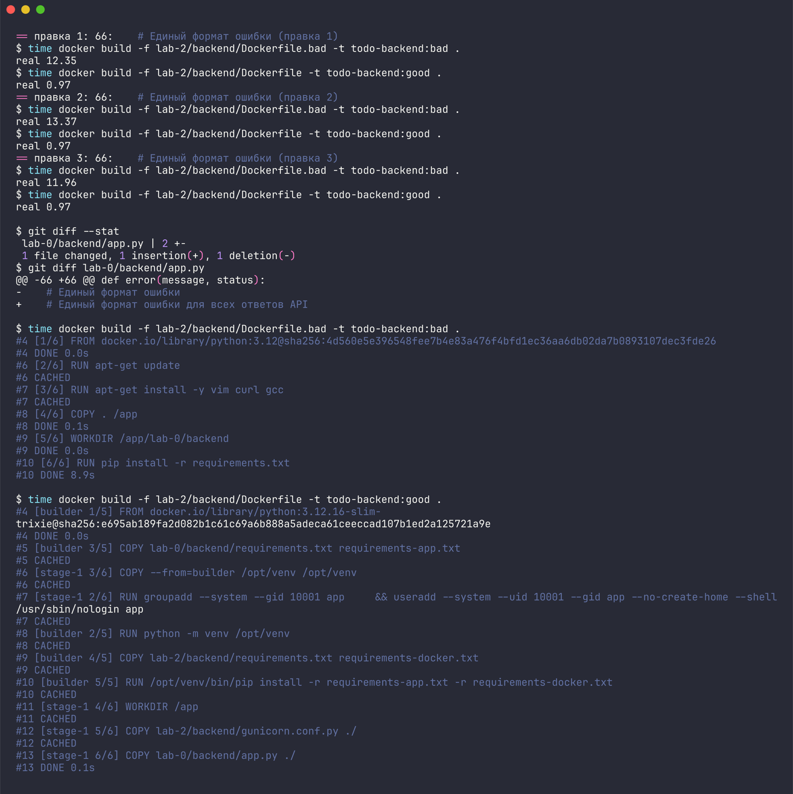

В плохом образе `COPY . /app` стоит до `pip install`. Изменился любой файл контекста, значит, изменилась контрольная сумма слоя `COPY`, а за ним сбрасываются все следующие слои, и Flask с psycopg2 ставятся заново (около 9 с на шаге `pip install`). В хорошем образе слой с зависимостями зависит только от двух `requirements.txt`, поэтому он берётся из кеша. Пересобирается лишь последний слой `COPY lab-0/backend/app.py`, это 0.1 с. Остальное время уходит на загрузку контекста и экспорт образа.

## docker compose

[docker-compose.yml](docker-compose.yml):

```yaml
# Стек лабы 2: фронтенд (nginx) → бэкенд (Flask + gunicorn) → PostgreSQL.
# Запуск из папки lab-2: docker compose up -d --build
name: lab2

services:
  db:
    image: postgres:16.15-alpine3.24
    environment:
      POSTGRES_DB: ${DB_NAME:-todo}
      POSTGRES_USER: ${DB_USER:-todo}
      POSTGRES_PASSWORD: ${DB_PASSWORD:?задайте DB_PASSWORD в lab-2/.env}
    volumes:
      # Данные в именованном томе переживают удаление контейнера
      - pgdata:/var/lib/postgresql/data
    networks:
      - backend-net
    healthcheck:
      test: ["CMD-SHELL", "pg_isready -U \"$$POSTGRES_USER\" -d \"$$POSTGRES_DB\""]
      interval: 5s
      timeout: 3s
      retries: 5
      start_period: 10s
    restart: always
    deploy:
      resources:
        limits:
          cpus: "${DB_CPUS:-2.0}"
          memory: ${DB_MEMORY:-128m}

  backend:
    build:
      context: ..
      dockerfile: lab-2/backend/Dockerfile
    image: todo-backend:good
    environment:
      DB_HOST: db
      DB_PORT: "5432"
      DB_NAME: ${DB_NAME:-todo}
      DB_USER: ${DB_USER:-todo}
      DB_PASSWORD: ${DB_PASSWORD:?задайте DB_PASSWORD в lab-2/.env}
      PORT: "8000"
      INSTANCE_ID: backend-docker
      WEB_CONCURRENCY: ${WEB_CONCURRENCY:-4}
    # Бэкенд стартует только после того, как healthcheck БД стал healthy
    depends_on:
      db:
        condition: service_healthy
    # Бэкенд единственный, кто подключён к обеим сетям
    networks:
      - frontend-net
      - backend-net
    restart: always
    deploy:
      resources:
        limits:
          cpus: "${BACKEND_CPUS:-2.0}"
          memory: ${BACKEND_MEMORY:-128m}

  frontend:
    build:
      context: ..
      dockerfile: lab-2/frontend/Dockerfile
    image: todo-frontend:good
    ports:
      # Наружу опубликован только фронтенд, и только на loopback
      - "127.0.0.1:${FRONTEND_PORT:-8080}:8080"
    depends_on:
      backend:
        condition: service_healthy
    networks:
      - frontend-net
    restart: always
    deploy:
      resources:
        limits:
          cpus: "${FRONTEND_CPUS:-0.5}"
          memory: ${FRONTEND_MEMORY:-64m}

networks:
  # Фронтенд и бэкенд
  frontend-net:
  # Бэкенд и БД. internal: у сети нет выхода наружу, а фронтенд в неё не входит
  backend-net:
    internal: true

volumes:
  pgdata:
```

Образ фронтенда, [frontend/Dockerfile](frontend/Dockerfile):

```dockerfile
# Фронтенд: статика из лабы 0 и прокси /api на бэкенд.
# Собирается из корня репозитория:
#   docker build -f lab-2/frontend/Dockerfile -t todo-frontend .
# Образ nginx, который сразу работает от непривилегированного пользователя nginx (uid 101)
FROM nginxinc/nginx-unprivileged:1.30.6-alpine3.24
COPY lab-2/frontend/nginx.conf /etc/nginx/conf.d/default.conf
COPY lab-0/frontend/ /usr/share/nginx/html/
EXPOSE 8080
HEALTHCHECK --interval=10s --timeout=3s --start-period=5s --retries=3 \
    CMD ["wget", "-q", "-O", "/dev/null", "http://127.0.0.1:8080/"]
```

[frontend/nginx.conf](frontend/nginx.conf):

```nginx
server {
    listen 8080;
    server_name _;
    server_tokens off;

    root /usr/share/nginx/html;
    index index.html;

    # DNS Docker: имя backend перечитывается, если контейнер бэкенда
    # пересоздан и получил новый адрес
    resolver 127.0.0.11 valid=10s ipv6=off;
    set $backend http://backend:8000;

    proxy_connect_timeout 2s;
    proxy_read_timeout 10s;
    proxy_set_header Host $host;
    proxy_set_header X-Forwarded-For $proxy_add_x_forwarded_for;

    # API и проверка живости уходят во Flask, путь передаётся как есть
    location /api/ {
        proxy_pass $backend;
    }

    location = /health {
        proxy_pass $backend;
    }

    location / {
        try_files $uri $uri/ =404;
    }
}
```

Пароль БД лежит только в `lab-2/.env`, который исключён из git. Шаблон — [.env.example](.env.example).

### Запуск всех контейнеров

```text
$ docker compose up -d --build --wait
 Image todo-backend:good Built 
 Image todo-frontend:good Built 
 Network lab2_frontend-net Creating 
 Network lab2_backend-net Creating 
 Network lab2_frontend-net Creating 
 Network lab2_backend-net Creating 
 Network lab2_backend-net Created 
 Network lab2_backend-net Created 
 Container lab2-db-1 Creating 
 Network lab2_frontend-net Created 
 Network lab2_frontend-net Created 
 Container lab2-db-1 Created 
 Container lab2-backend-1 Creating 
 Container lab2-backend-1 Created 
 Container lab2-frontend-1 Creating 
 Container lab2-frontend-1 Created 
 Container lab2-db-1 Starting 
 Container lab2-db-1 Started 
 Container lab2-db-1 Waiting 
 Container lab2-db-1 Healthy 
 Container lab2-backend-1 Starting 
 Container lab2-backend-1 Started 
 Container lab2-backend-1 Waiting 
 Container lab2-backend-1 Healthy 
 Container lab2-frontend-1 Starting 
 Container lab2-frontend-1 Started 
 Container lab2-frontend-1 Waiting 
 Container lab2-db-1 Waiting 
 Container lab2-backend-1 Waiting 
 Container lab2-db-1 Healthy 
 Container lab2-backend-1 Healthy 
 Container lab2-frontend-1 Healthy 

$ docker compose ps
NAME              IMAGE                       STATUS                    PORTS
lab2-backend-1    todo-backend:good           Up 10 seconds (healthy)   8000/tcp
lab2-db-1         postgres:16.15-alpine3.24   Up 16 seconds (healthy)   5432/tcp
lab2-frontend-1   todo-frontend:good          Up 5 seconds (healthy)    127.0.0.1:8080->8080/tcp
```

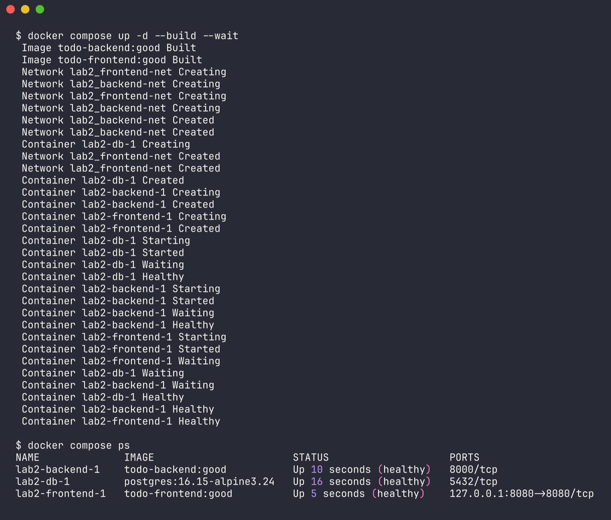

Порядок запуска виден по логу: БД стала `Healthy`, только потом стартовал бэкенд, и только после его `Healthy` стартовал фронтенд.

### Проверки

Все проверки обычной части выполняет [check.sh](check.sh), вывод приведён целиком:

```text
== Образы

$ docker images --format table {{.Repository}}\t{{.Tag}}\t{{.Size}} --filter reference=todo-*
REPOSITORY      TAG       SIZE
todo-backend    good      243MB
todo-frontend   good      90.7MB
todo-backend    bad       1.78GB
PASS  хороший образ меньше плохого (231 МБ < 1695 МБ)

== Контейнеры

$ docker compose ps --format table {{.Name}}\t{{.Image}}\t{{.Status}}\t{{.Ports}}
NAME              IMAGE                       STATUS                        PORTS
lab2-backend-1    todo-backend:good           Up About a minute (healthy)   8000/tcp
lab2-db-1         postgres:16.15-alpine3.24   Up 2 minutes (healthy)        5432/tcp
lab2-frontend-1   todo-frontend:good          Up About a minute (healthy)   127.0.0.1:8080->8080/tcp
PASS  все три сервиса healthy

== Пользователи
$ docker compose exec frontend whoami
nginx
PASS  frontend работает не от root
$ docker compose exec backend whoami
app
PASS  backend работает не от root

$ docker compose exec -T db ps -o user,args
USER     COMMAND
postgres postgres
postgres postgres: checkpointer 
postgres postgres: background writer 
postgres postgres: walwriter 
postgres postgres: autovacuum launcher 
postgres postgres: logical replication launcher 
root     ps -o user,args
PASS  процессы PostgreSQL работают от postgres

== Связь фронтенд → бэкенд → БД

$ curl -s -i http://127.0.0.1:8080/health
HTTP/1.1 200 OK
Server: nginx
Date: Thu, 05 Nov 2026 11:53:23 GMT
Content-Type: application/json
Content-Length: 57
Connection: keep-alive
X-Instance-Id: backend-docker

{"db":"ok","instance_id":"backend-docker","status":"ok"}
PASS  GET /health через фронтенд отвечает 200

$ curl -s -X POST http://127.0.0.1:8080/api/tasks -H Content-Type: application/json -d {"text": "Проверка тома 14:53:23"}
{"instance_id":"backend-docker","task":{"created_at":"2026-11-05T11:53:23.884405+00:00","id":34,"text":"Проверка тома 14:53:23"}}

== Именованный том

$ docker volume ls --filter name=lab2_pgdata
DRIVER    VOLUME NAME
local     lab2_pgdata

$ docker rm -f 0116a8dbd1a90a613922b44439cdd86a488c6d3fca0a7bf08f7690da378ab49b
0116a8dbd1a90a613922b44439cdd86a488c6d3fca0a7bf08f7690da378ab49b

$ docker compose up -d --wait db
 Container lab2-db-1 Creating 
 Container lab2-db-1 Created 
 Container lab2-db-1 Starting 
 Container lab2-db-1 Started 
 Container lab2-db-1 Waiting 
 Container lab2-db-1 Healthy 
контейнер БД: было 0116a8dbd1a9, стало e7d52f7984fd

$ curl -s http://127.0.0.1:8080/api/tasks
{"instance_id":"backend-docker","tasks":[{"created_at":"2026-11-05T11:53:23.884405+00:00","id":34,"text":"Проверка тома 14:53:23"},{"created_at":"2026-11-05T11:32:13.960757+00:00","id":1,"text":"Запись до docker rm"}]}

PASS  запись «Проверка тома 14:53:23» сохранилась после docker rm

== Сетевая изоляция
lab2_frontend-net internal=false: lab2-backend-1 lab2-frontend-1 
lab2_backend-net internal=true: lab2-backend-1 lab2-db-1 

$ docker compose exec -T backend python -c import socket; socket.create_connection(('db', 5432), 3); print('db:5432 open')
db:5432 open
PASS  бэкенд подключается к db:5432

$ docker compose exec -T frontend nc -zv -w 3 db 5432
nc: bad address 'db'
PASS  фронтенд не находит БД по имени

$ docker compose exec -T frontend nc -zv -w 3 172.18.0.2 5432
nc: 172.18.0.2 (172.18.0.2:5432): Operation timed out
PASS  фронтенд не подключается к БД по IP 172.18.0.2

Итог: PASS=10 FAIL=0
```

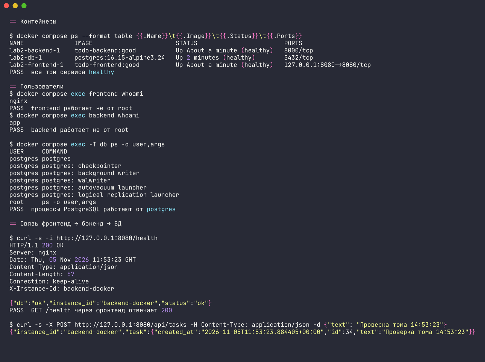

- **Пользователи.** `docker compose exec backend whoami` возвращает `app`, во фронтенде — `nginx`. У `db` команда `exec` по умолчанию выполняется от root, потому что в официальном образе postgres нет `USER`, но сам сервер entrypoint запускает от пользователя `postgres`. Это видно по `ps`.
- **Связь.** `GET /health` через фронтенд возвращает 200 с `"db":"ok"`: запрос прошёл nginx → gunicorn → PostgreSQL.

### Данные в именованном томе

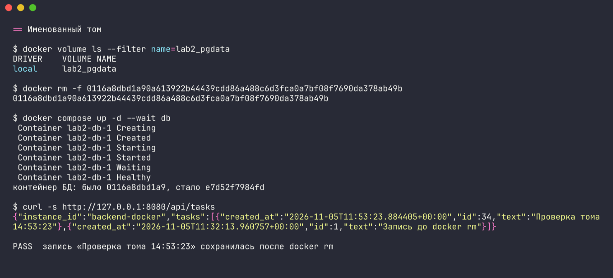

Задача записана через API, контейнер БД удалён командой `docker rm -f` и поднят заново: ID контейнера поменялся, а запись осталась. Проверка выдерживает и полное пересоздание стека через `docker compose down` и `docker compose up` без `-v`:

```text
$ docker top lab2-db-1 -o user,args | head -4
Error response from daemon: Couldn't find PID field in ps output

$ docker volume ls --filter name=lab2
DRIVER    VOLUME NAME
local     lab2_pgdata
$ docker inspect lab2-db-1 --format "{{range .Mounts}}{{.Type}} {{.Name}} -> {{.Destination}}{{end}}"
volume lab2_pgdata -> /var/lib/postgresql/data

$ docker inspect -f "{{.Id}}" lab2-db-1 | cut -c1-12
f525f44593b6
$ docker rm -f lab2-db-1
lab2-db-1
$ docker ps -a --filter name=lab2-db
NAMES     STATUS
$ docker compose up -d --wait db
 Container lab2-db-1 Waiting 
 Container lab2-db-1 Healthy 
$ docker inspect -f "{{.Id}}" lab2-db-1 | cut -c1-12
9bdce6218750
$ curl -s http://localhost:8080/api/tasks
{"instance_id":"backend-docker","tasks":[{"created_at":"2026-11-05T11:32:13.960757+00:00","id":1,"text":"Запись до docker rm"}]}

$ docker compose exec db psql -U todo -d todo -c 'SELECT id, text FROM tasks;'
 id |        text         
----+---------------------
  1 | Запись до docker rm
(1 row)

$ docker compose down   # без -v, том остаётся
 Container lab2-db-1 Removed 
 Network lab2_backend-net Removing 
 Network lab2_frontend-net Removing 
 Network lab2_frontend-net Removed 
 Network lab2_backend-net Removed 
$ docker volume ls --filter name=lab2
DRIVER    VOLUME NAME
local     lab2_pgdata
$ docker compose up -d --wait
 Container lab2-backend-1 Healthy 
 Container lab2-db-1 Healthy 
 Container lab2-frontend-1 Healthy 
$ curl -s http://localhost:8080/api/tasks
{"instance_id":"backend-docker","tasks":[{"created_at":"2026-11-05T11:32:13.960757+00:00","id":1,"text":"Запись до docker rm"}]}
```

### Сетевая изоляция

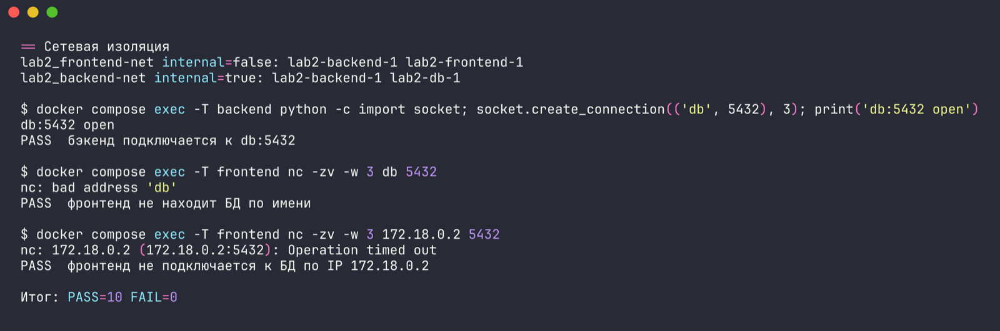

Фронтенд подключён только к `frontend-net`, БД — только к `backend-net`, и в обеих сетях есть лишь бэкенд. Поэтому:

- `nc -zv db 5432` из фронтенда завершается `bad address 'db'`: во встроенном DNS сети `frontend-net` такого имени нет.
- По IP-адресу БД из `backend-net` (`172.18.0.2`) соединение не устанавливается: `Operation timed out`, код выхода 1. У контейнера фронтенда нет интерфейса в этой подсети, а сеть `internal`.
- Бэкенд с тем же `db:5432` соединяется, и фронтенд до бэкенда доходит.

## Задание со звёздочкой: самовосстановление

Что настроено в [docker-compose.yml](docker-compose.yml):

- **healthcheck** у всех сервисов. У БД `pg_isready` каждые 5 с. У бэкенда `HEALTHCHECK` из Dockerfile, он запрашивает `/health`, а тот делает `SELECT 1`. У фронтенда `wget` главной страницы.
- **`restart: always`** у всех сервисов: Docker перезапускает контейнер, когда его главный процесс завершился.
- **`depends_on` с `condition: service_healthy`**: бэкенд ждёт healthy БД, фронтенд ждёт healthy бэкенда.
- **Переподключение.** Бэкенд открывает новое соединение с БД на каждый запрос (так сделано ещё в лабе 0), поэтому после возвращения БД он переподключается сам, без перезапуска. Пока БД нет, он отвечает 503 и не падает. nginx перечитывает адрес `backend` через DNS Docker (`resolver 127.0.0.11 valid=10s`), так что пересоздание бэкенда ему тоже не мешает.

### Как гасилась БД

Сначала контейнер БД был остановлен через `docker kill lab2-db-1`, и Docker его **не** поднял: 10 секунд подряд он оставался `exited restarts=0`, а `/health` отвечал 503. Так и должно быть: команды `docker stop` и `docker kill` Docker считает ручной остановкой и политику `restart` к ним не применяет, иначе контейнер нельзя было бы остановить. Политика срабатывает, когда процесс в контейнере падает сам.

Поэтому падение имитировалось изнутри: главному процессу PostgreSQL отправлялся SIGQUIT. Это «immediate shutdown», при котором сервер выходит сразу, без контрольной точки, как при аварии. Демонстрацию выполняет [scripts/selfheal.sh](scripts/selfheal.sh), он опрашивает API каждые 0.2 с:

```text
До сбоя:
14:54:14  db: running healthy restarts=0      GET /api/tasks -> 200

$ docker compose exec db kill -QUIT 1   # immediate shutdown, как при падении
14:54:14  db: restarting unhealthy restarts=1  GET /api/tasks -> 503
14:54:14  db: running starting restarts=1     GET /api/tasks -> 200
14:54:14  db: running starting restarts=1     GET /api/tasks -> 200
14:54:15  db: running starting restarts=1     GET /api/tasks -> 200
14:54:15  db: running starting restarts=1     GET /api/tasks -> 200
14:54:15  db: running starting restarts=1     GET /api/tasks -> 200
14:54:16  db: running starting restarts=1     GET /api/tasks -> 200
14:54:16  db: running starting restarts=1     GET /api/tasks -> 200
14:54:16  db: running starting restarts=1     GET /api/tasks -> 200
14:54:16  db: running starting restarts=1     GET /api/tasks -> 200
14:54:17  db: running starting restarts=1     GET /api/tasks -> 200
14:54:17  db: running starting restarts=1     GET /api/tasks -> 200
14:54:17  db: running starting restarts=1     GET /api/tasks -> 200
14:54:18  db: running starting restarts=1     GET /api/tasks -> 200
14:54:18  db: running starting restarts=1     GET /api/tasks -> 200
14:54:18  db: running starting restarts=1     GET /api/tasks -> 200
14:54:18  db: running starting restarts=1     GET /api/tasks -> 200
14:54:19  db: running starting restarts=1     GET /api/tasks -> 200
14:54:19  db: running starting restarts=1     GET /api/tasks -> 200
14:54:19  db: running healthy restarts=1      GET /api/tasks -> 200
14:54:20  db: running healthy restarts=1      GET /api/tasks -> 200
14:54:20  db: running healthy restarts=1      GET /api/tasks -> 200

$ curl -s http://127.0.0.1:8080/api/tasks
{"instance_id":"backend-docker","tasks":[{"created_at":"2026-11-05T11:53:23.884405+00:00","id":34,"text":"Проверка тома 14:53:23"},{"created_at":"2026-11-05T11:32:13.960757+00:00","id":1,"text":"Запись до docker rm"}]}

Журнал бэкенда за время сбоя:
172.19.0.3 - - [05/Nov/2026:11:54:14 +0000] "GET /api/tasks HTTP/1.1" 200 239 "-" "curl/8.7.1"
[2026-11-05 11:54:14,387] ERROR in app: БД недоступна: could not translate host name "db" to address: Name or service not known
172.19.0.3 - - [05/Nov/2026:11:54:14 +0000] "GET /api/tasks HTTP/1.1" 503 64 "-" "curl/8.7.1"
172.19.0.3 - - [05/Nov/2026:11:54:14 +0000] "GET /api/tasks HTTP/1.1" 200 239 "-" "curl/8.7.1"
172.19.0.3 - - [05/Nov/2026:11:54:20 +0000] "GET /api/tasks HTTP/1.1" 200 239 "-" "curl/8.7.1"
```

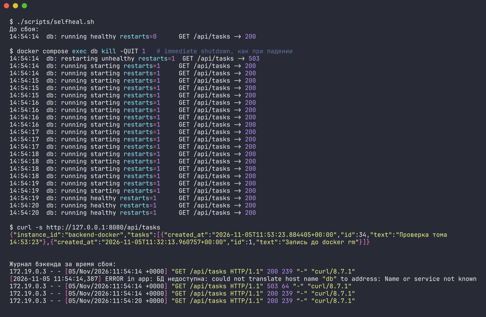

Хронология:

1. **БД упала.** Контейнер перешёл в `restarting`, и ровно один запрос в этот момент получил 503. В логе бэкенда видно, что имя `db` перестало разрешаться: у остановленного контейнера нет адреса в сети.
2. **Стек поднял БД сам.** Docker перезапустил контейнер (счётчик `restarts` вырос) меньше чем за секунду.
3. **Сайт снова отвечает.** PostgreSQL выполнил восстановление после сбоя, и уже следующий запрос получил 200. Healthcheck вернулся в `healthy` примерно через 5 с, по интервалу проверки.
4. **Данные целы.** `curl` после восстановления вернул те же задачи.

Побочный эффект: после аварийного завершения PostgreSQL сдвигает последовательности на 32 значения вперёд. Поэтому задача, записанная после сбоев, получила `id` 34, а не 2. Это нормальное поведение `SERIAL`, данные не потеряны.

## Задание со звёздочкой: лимиты под нагрузкой

Лимиты заданы в `deploy.resources.limits` каждого сервиса и берутся из переменных `BACKEND_CPUS`, `BACKEND_MEMORY`, `DB_CPUS`, `DB_MEMORY`, `FRONTEND_CPUS`, `FRONTEND_MEMORY`, а число воркеров gunicorn — из `WEB_CONCURRENCY`. Значения по умолчанию в compose и `.env.example` — итоговые подобранные.

[scripts/load.sh](scripts/load.sh) пересоздаёт стек с заданными лимитами и запускает `hey -z 30s -c 50 http://127.0.0.1:8080/api/tasks`, то есть 50 параллельных клиентов в течение 30 секунд. Каждый запрос — чтение списка задач из БД. Каждые 5 с скрипт снимает `docker stats` и читает внутри контейнеров счётчики cgroup v2: `nr_throttled` и `throttled_usec` из `cpu.stat` показывают троттлинг CPU, `oom_kill` из `memory.events` — срабатывания OOM killer. Кроме того, учитываются события `oom` от `docker events`: в отличие от `memory.events`, они не обнуляются при перезапуске контейнера.

### Сводка

| Прогон | backend: CPU / память / воркеры | db: CPU / память | Запросов/с | p50 / p99 | Ответы | Что произошло |
|---|---|---|---|---|---|---|
| исходные | 1.0 / 256m / 2 | 1.0 / 256m | 178.9 | 0.26 / 0.52 с | 5416 × 200 | БД упирается в 1 CPU, троттлинг БД 27.6 с за прогон |
| тесный CPU | 0.1 / 256m / 2 | 0.1 / 256m | — | — | 0, все `connection refused` | бэкенд не прошёл healthcheck, фронтенд не стартовал |
| троттлинг | 0.25 / 256m / 2 | 0.25 / 256m | 23.1 | среднее 2.09 с | 740 × 200 | CPU упёрся в 25%, троттлинг: бэкенд 19.1 с, БД 50.0 с |
| тесная память | 1.0 / 32m / 2 | 1.0 / 256m | — | — | 0, все `connection refused` | OOM при старте воркеров, 24 события `oom`, перезапуски |
| OOM под нагрузкой | 1.0 / 56m / 4 | 1.0 / 256m | 178.7 | 0.29 / 0.50 с | 5403 × 200, 4 × 502 | `oom_kill 4`, `OOMKilled=true`, оборванные запросы |
| **итоговые, 60 с** | **2.0 / 128m / 4** | **2.0 / 128m** | **289.0** | **0.17 / 0.35 с** | **17396 × 200** | ошибок и OOM нет, бэкенд почти не троттлится |

Промежуточные прогоны без отдельных скриншотов: бэкенд на 2 воркерах держится и при 48 МБ, и при 40 МБ (209.7 и 189.0 запросов/с, только ответы 200). Под нагрузкой он занимает 26–34 МБ, и граница OOM для двух воркеров лежит между 32 и 40 МБ. Вариант с 4 воркерами при backend 1.0 CPU / 128m и db 2.0 CPU дал 283.2 запроса/с без ошибок, но с полностью занятым CPU бэкенда (троттлинг 39.0 с за прогон). Отсюда итоговые 2 CPU для бэкенда.

Самый первый прогон с исходными лимитами дал 89.5 запроса/с при тех же лимитах. Он шёл сразу после первого запуска стека на «холодной» системе. Повторные прогоны с теми же значениями стабильно дают 178–210 запросов/с, в таблицу взят повторный.

### Первые лимиты: слишком тесный CPU (0.1)

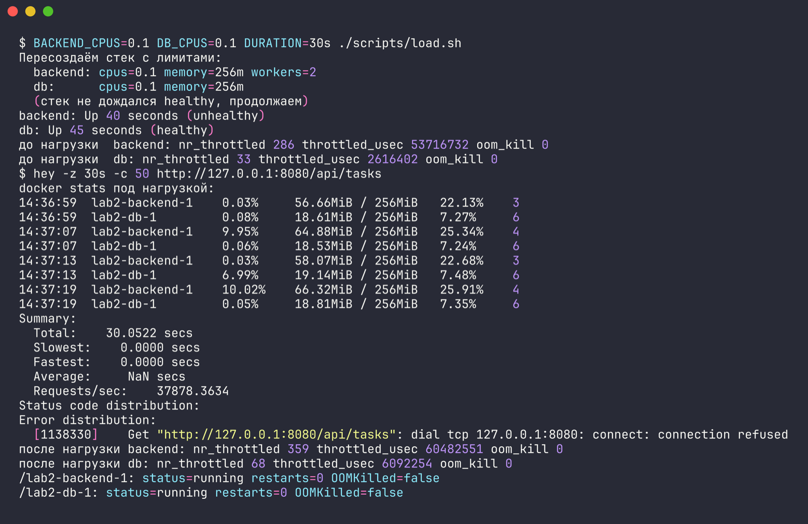

При 0.1 CPU бэкенд запускался больше 40 секунд. Healthcheck (`python -c ...` с таймаутом 3 с) не укладывался во время, контейнер остался `unhealthy`, и `depends_on: service_healthy` не дал стартовать фронтенду. Все запросы `hey` получили `connection refused`. Слишком тесный лимит CPU ломает не только скорость, но и запуск по зависимостям.

### Троттлинг CPU (0.25)

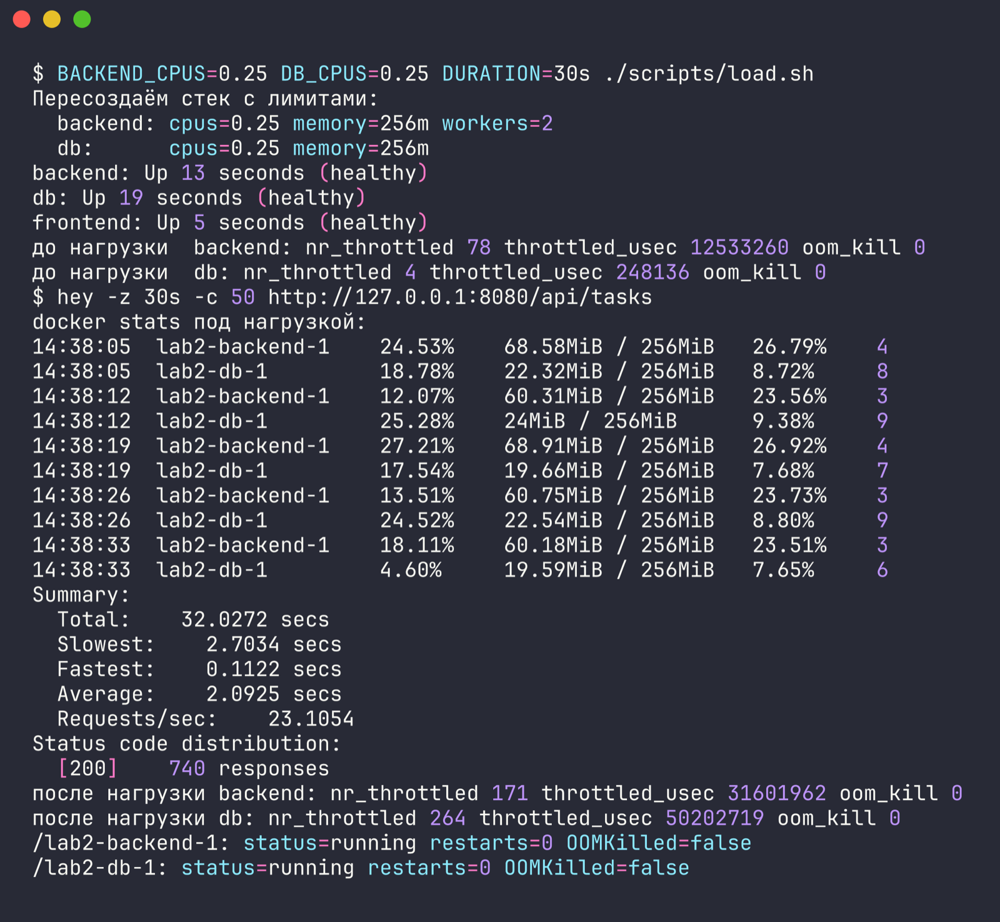

```text
$ BACKEND_CPUS=0.25 DB_CPUS=0.25 DURATION=30s ./scripts/load.sh
Пересоздаём стек с лимитами:
  backend: cpus=0.25 memory=256m workers=2
  db:      cpus=0.25 memory=256m
backend: Up 13 seconds (healthy)
db: Up 19 seconds (healthy)
frontend: Up 5 seconds (healthy)
до нагрузки  backend: nr_throttled 78 throttled_usec 12533260 oom_kill 0
до нагрузки  db: nr_throttled 4 throttled_usec 248136 oom_kill 0
$ hey -z 30s -c 50 http://127.0.0.1:8080/api/tasks
docker stats под нагрузкой:
14:38:05  lab2-backend-1    24.53%    68.58MiB / 256MiB   26.79%    4
14:38:05  lab2-db-1         18.78%    22.32MiB / 256MiB   8.72%     8
14:38:12  lab2-backend-1    12.07%    60.31MiB / 256MiB   23.56%    3
14:38:12  lab2-db-1         25.28%    24MiB / 256MiB      9.38%     9
14:38:19  lab2-backend-1    27.21%    68.91MiB / 256MiB   26.92%    4
14:38:19  lab2-db-1         17.54%    19.66MiB / 256MiB   7.68%     7
14:38:26  lab2-backend-1    13.51%    60.75MiB / 256MiB   23.73%    3
14:38:26  lab2-db-1         24.52%    22.54MiB / 256MiB   8.80%     9
14:38:33  lab2-backend-1    18.11%    60.18MiB / 256MiB   23.51%    3
14:38:33  lab2-db-1         4.60%     19.59MiB / 256MiB   7.65%     6
Summary:
  Total:	32.0272 secs
  Slowest:	2.7034 secs
  Fastest:	0.1122 secs
  Average:	2.0925 secs
  Requests/sec:	23.1054
Status code distribution:
  [200]	740 responses
после нагрузки backend: nr_throttled 171 throttled_usec 31601962 oom_kill 0
после нагрузки db: nr_throttled 264 throttled_usec 50202719 oom_kill 0
/lab2-backend-1: status=running restarts=0 OOMKilled=false
/lab2-db-1: status=running restarts=0 OOMKilled=false
```

В `docker stats` CPU обоих контейнеров не поднимается выше примерно 25%. Это и есть потолок `cpus: 0.25`: квота CFS исчерпывается, и процессы ждут следующего периода. По счётчикам cgroup бэкенд за 32 с провёл в троттлинге 19.1 с, БД 50.0 с (время суммируется по ядрам). Ошибок нет, но пропускная способность упала с 179 до 23 запросов/с, а средняя задержка выросла с 0.28 до 2.09 с.

### OOM: слишком тесная память (32m)

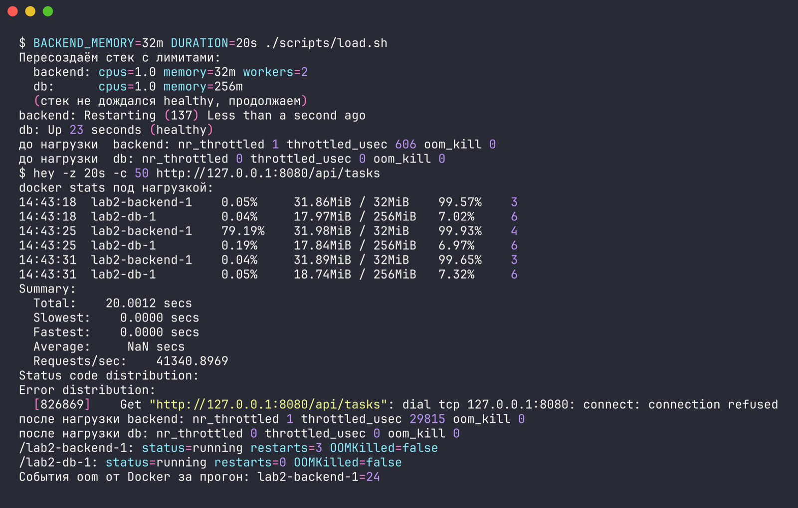

```text
$ BACKEND_MEMORY=32m DURATION=20s ./scripts/load.sh
Пересоздаём стек с лимитами:
  backend: cpus=1.0 memory=32m workers=2
  db:      cpus=1.0 memory=256m
  (стек не дождался healthy, продолжаем)
backend: Restarting (137) Less than a second ago
db: Up 23 seconds (healthy)
до нагрузки  backend: nr_throttled 1 throttled_usec 606 oom_kill 0
до нагрузки  db: nr_throttled 0 throttled_usec 0 oom_kill 0
$ hey -z 20s -c 50 http://127.0.0.1:8080/api/tasks
docker stats под нагрузкой:
14:43:18  lab2-backend-1    0.05%     31.86MiB / 32MiB    99.57%    3
14:43:18  lab2-db-1         0.04%     17.97MiB / 256MiB   7.02%     6
14:43:25  lab2-backend-1    79.19%    31.98MiB / 32MiB    99.93%    4
14:43:25  lab2-db-1         0.19%     17.84MiB / 256MiB   6.97%     6
14:43:31  lab2-backend-1    0.04%     31.89MiB / 32MiB    99.65%    3
14:43:31  lab2-db-1         0.05%     18.74MiB / 256MiB   7.32%     6
Summary:
  Total:	20.0012 secs
  Slowest:	0.0000 secs
  Fastest:	0.0000 secs
  Average:	 NaN secs
  Requests/sec:	41340.8969
Status code distribution:
Error distribution:
  [826869]	Get "http://127.0.0.1:8080/api/tasks": dial tcp 127.0.0.1:8080: connect: connection refused
после нагрузки backend: nr_throttled 1 throttled_usec 29815 oom_kill 0
после нагрузки db: nr_throttled 0 throttled_usec 0 oom_kill 0
/lab2-backend-1: status=running restarts=3 OOMKilled=false
/lab2-db-1: status=running restarts=0 OOMKilled=false
События oom от Docker за прогон: lab2-backend-1=24 
```

Мастер gunicorn и два воркера с Flask и psycopg2 не помещаются в 32 МБ. Ядро убивает воркеры, в логе gunicorn это `Worker (pid:35) was sent SIGKILL! Perhaps out of memory?`. Иногда убивается и сам мастер, тогда Docker перезапускает контейнер (`Restarting (137)`, `restarts=3`). За 20 с прогона Docker зафиксировал 24 события `oom`. Бэкенд ни разу не стал healthy, фронтенд не стартовал.

### OOM под нагрузкой (4 воркера, 56m)

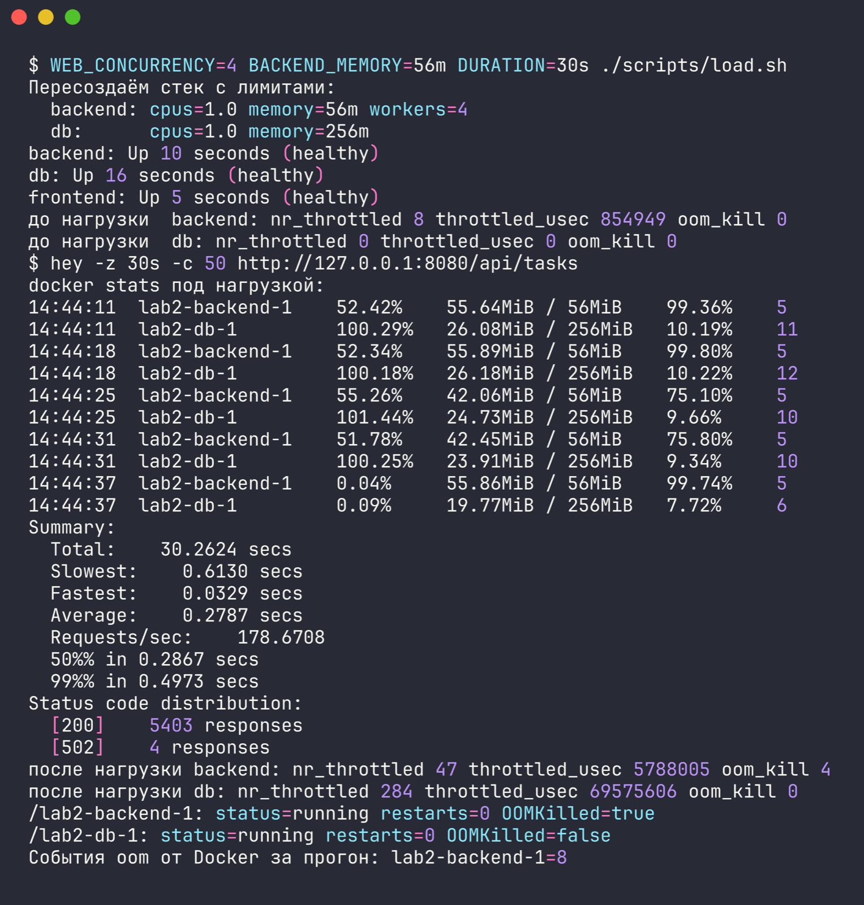

```text
$ WEB_CONCURRENCY=4 BACKEND_MEMORY=56m DURATION=30s ./scripts/load.sh
Пересоздаём стек с лимитами:
  backend: cpus=1.0 memory=56m workers=4
  db:      cpus=1.0 memory=256m
backend: Up 10 seconds (healthy)
db: Up 16 seconds (healthy)
frontend: Up 5 seconds (healthy)
до нагрузки  backend: nr_throttled 8 throttled_usec 854949 oom_kill 0
до нагрузки  db: nr_throttled 0 throttled_usec 0 oom_kill 0
$ hey -z 30s -c 50 http://127.0.0.1:8080/api/tasks
docker stats под нагрузкой:
14:44:11  lab2-backend-1    52.42%    55.64MiB / 56MiB    99.36%    5
14:44:11  lab2-db-1         100.29%   26.08MiB / 256MiB   10.19%    11
14:44:18  lab2-backend-1    52.34%    55.89MiB / 56MiB    99.80%    5
14:44:18  lab2-db-1         100.18%   26.18MiB / 256MiB   10.22%    12
14:44:25  lab2-backend-1    55.26%    42.06MiB / 56MiB    75.10%    5
14:44:25  lab2-db-1         101.44%   24.73MiB / 256MiB   9.66%     10
14:44:31  lab2-backend-1    51.78%    42.45MiB / 56MiB    75.80%    5
14:44:31  lab2-db-1         100.25%   23.91MiB / 256MiB   9.34%     10
14:44:37  lab2-backend-1    0.04%     55.86MiB / 56MiB    99.74%    5
14:44:37  lab2-db-1         0.09%     19.77MiB / 256MiB   7.72%     6
Summary:
  Total:	30.2624 secs
  Slowest:	0.6130 secs
  Fastest:	0.0329 secs
  Average:	0.2787 secs
  Requests/sec:	178.6708
  50%% in 0.2867 secs
  99%% in 0.4973 secs
Status code distribution:
  [200]	5403 responses
  [502]	4 responses
после нагрузки backend: nr_throttled 47 throttled_usec 5788005 oom_kill 4
после нагрузки db: nr_throttled 284 throttled_usec 69575606 oom_kill 0
/lab2-backend-1: status=running restarts=0 OOMKilled=true
/lab2-db-1: status=running restarts=0 OOMKilled=false
События oom от Docker за прогон: lab2-backend-1=8 
```

Этот вариант стартует нормально и проходит healthcheck. Под нагрузкой память упирается в лимит (55.9 из 56 МБ), и OOM killer убивает воркеры прямо во время обработки запросов (`oom_kill 4`, `OOMKilled=true`). Клиенты, чьи запросы обрабатывал убитый воркер, получили 502 от nginx. Gunicorn поднимает новые воркеры, поэтому сервис в целом жив, но теряет запросы.

### Итоговые значения

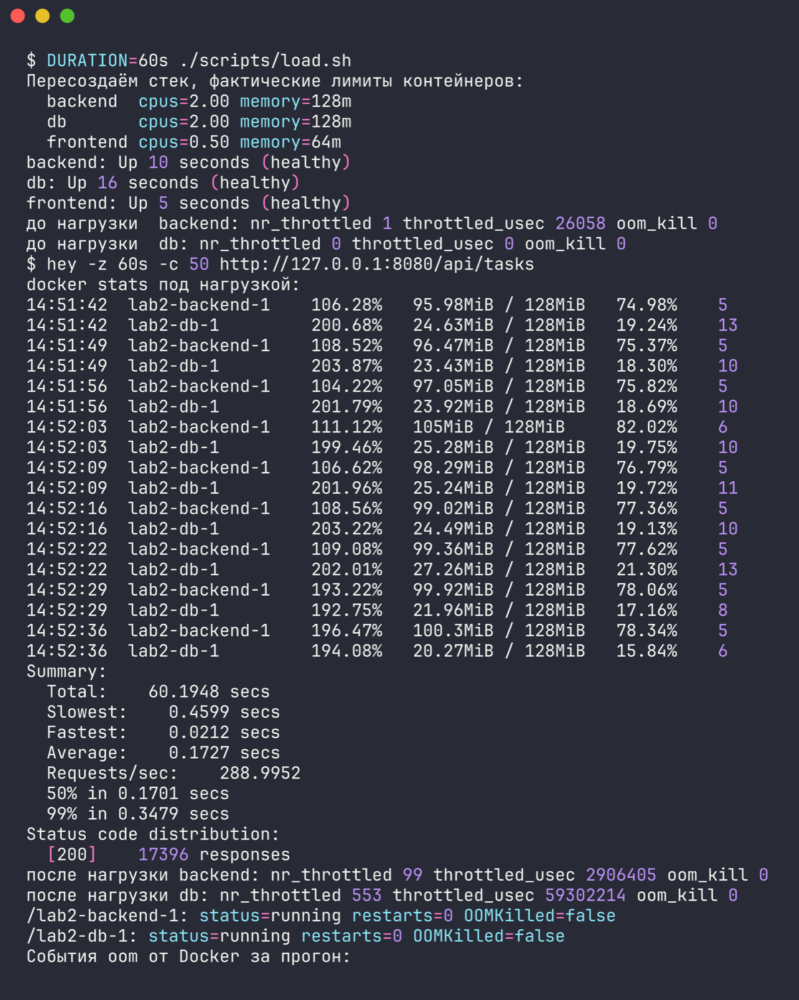

```text
Пересоздаём стек, фактические лимиты контейнеров:
  backend  cpus=2.00 memory=128m
  db       cpus=2.00 memory=128m
  frontend cpus=0.50 memory=64m
backend: Up 10 seconds (healthy)
db: Up 16 seconds (healthy)
frontend: Up 5 seconds (healthy)

до нагрузки  backend: nr_throttled 1 throttled_usec 26058 oom_kill 0
до нагрузки  db: nr_throttled 0 throttled_usec 0 oom_kill 0

$ hey -z 60s -c 50 http://127.0.0.1:8080/api/tasks
docker stats под нагрузкой:
14:51:42  NAME              CPU %     MEM USAGE / LIMIT   MEM %     PIDS
14:51:42  lab2-backend-1    106.28%   95.98MiB / 128MiB   74.98%    5
14:51:42  lab2-db-1         200.68%   24.63MiB / 128MiB   19.24%    13
14:51:42  lab2-frontend-1   8.56%     10.26MiB / 64MiB    16.03%    9
14:51:49  NAME              CPU %     MEM USAGE / LIMIT   MEM %     PIDS
14:51:49  lab2-backend-1    108.52%   96.47MiB / 128MiB   75.37%    5
14:51:49  lab2-db-1         203.87%   23.43MiB / 128MiB   18.30%    10
14:51:49  lab2-frontend-1   9.52%     10.49MiB / 64MiB    16.39%    9
14:51:56  NAME              CPU %     MEM USAGE / LIMIT   MEM %     PIDS
14:51:56  lab2-backend-1    104.22%   97.05MiB / 128MiB   75.82%    5
14:51:56  lab2-db-1         201.79%   23.92MiB / 128MiB   18.69%    10
14:51:56  lab2-frontend-1   8.98%     10.93MiB / 64MiB    17.08%    9
14:52:03  NAME              CPU %     MEM USAGE / LIMIT   MEM %     PIDS
14:52:03  lab2-backend-1    111.12%   105MiB / 128MiB     82.02%    6
14:52:03  lab2-db-1         199.46%   25.28MiB / 128MiB   19.75%    10
14:52:03  lab2-frontend-1   8.80%     11.39MiB / 64MiB    17.79%    9
14:52:09  NAME              CPU %     MEM USAGE / LIMIT   MEM %     PIDS
14:52:09  lab2-backend-1    106.62%   98.29MiB / 128MiB   76.79%    5
14:52:09  lab2-db-1         201.96%   25.24MiB / 128MiB   19.72%    11
14:52:09  lab2-frontend-1   9.50%     11.72MiB / 64MiB    18.31%    9
14:52:16  NAME              CPU %     MEM USAGE / LIMIT   MEM %     PIDS
14:52:16  lab2-backend-1    108.56%   99.02MiB / 128MiB   77.36%    5
14:52:16  lab2-db-1         203.22%   24.49MiB / 128MiB   19.13%    10
14:52:16  lab2-frontend-1   9.20%     12.09MiB / 64MiB    18.90%    9
14:52:22  NAME              CPU %     MEM USAGE / LIMIT   MEM %     PIDS
14:52:22  lab2-backend-1    109.08%   99.36MiB / 128MiB   77.62%    5
14:52:22  lab2-db-1         202.01%   27.26MiB / 128MiB   21.30%    13
14:52:22  lab2-frontend-1   9.53%     12.45MiB / 64MiB    19.45%    9
14:52:29  NAME              CPU %     MEM USAGE / LIMIT   MEM %     PIDS
14:52:29  lab2-backend-1    193.22%   99.92MiB / 128MiB   78.06%    5
14:52:29  lab2-db-1         192.75%   21.96MiB / 128MiB   17.16%    8
14:52:29  lab2-frontend-1   9.38%     12.77MiB / 64MiB    19.95%    9
14:52:36  NAME              CPU %     MEM USAGE / LIMIT   MEM %     PIDS
14:52:36  lab2-backend-1    196.47%   100.3MiB / 128MiB   78.34%    5
14:52:36  lab2-db-1         194.08%   20.27MiB / 128MiB   15.84%    6
14:52:36  lab2-frontend-1   7.62%     13.25MiB / 64MiB    20.70%    9

Summary:
  Total:	60.1948 secs
  Slowest:	0.4599 secs
  Fastest:	0.0212 secs
  Average:	0.1727 secs
  Requests/sec:	288.9952
  50% in 0.1701 secs
  99% in 0.3479 secs
Status code distribution:
  [200]	17396 responses

после нагрузки backend: nr_throttled 99 throttled_usec 2906405 oom_kill 0
после нагрузки db: nr_throttled 553 throttled_usec 59302214 oom_kill 0
/lab2-backend-1: status=running restarts=0 OOMKilled=false
/lab2-db-1: status=running restarts=0 OOMKilled=false
События oom от Docker за прогон: 
```

| Сервис | CPU | Память | Использование под нагрузкой |
|---|---|---|---|
| backend (4 воркера) | 2.0 | 128m | 104–196% CPU, 96–100 МБ (75–78%) |
| db | 2.0 | 128m | около 200% CPU, 20–27 МБ |
| frontend | 0.5 | 64m | 8–10% CPU, 10–13 МБ |

На этих значениях 60-секундный прогон прошёл без единой ошибки: 17396 ответов 200, 289 запросов/с, p99 0.35 с, самый медленный запрос 0.46 с. OOM и перезапусков нет. Почему выбраны именно они:

- 4 воркера gunicorn вместо 2 убирают очередь к синхронным воркерам. Им нужно около 100 МБ, поэтому 128m дают запас примерно 25% на всплески. 56m, как видно выше, мало.
- 2 CPU у бэкенда: при 1 CPU он упирался в лимит и троттлился 39 с за прогон, при 2 CPU — 2.9 с за 60 с.
- 2 CPU у БД. Узким местом остаётся она, потому что бэкенд открывает новое соединение с SCRAM-аутентификацией на каждый запрос, и это дорого по CPU. Дальше пропускную способность поднимет пул соединений в коде, а не лимиты. Памяти БД при такой нагрузке нужно 20–27 МБ, 128m хватает с запасом.
- Фронтенду 0.5 CPU и 64m хватает с большим запасом.

Для сравнения — исходные лимиты:

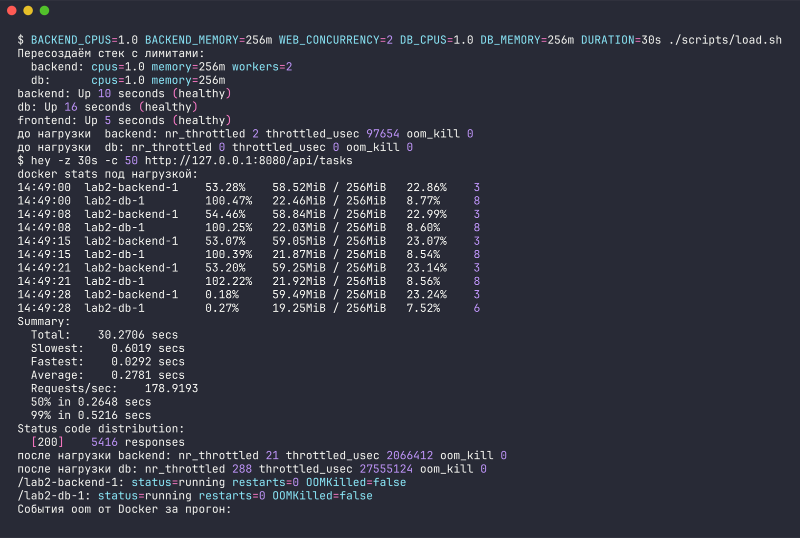

## Что проверено

- [x] плохой Dockerfile с восемью плохими практиками, хороший с их исправлением
- [x] multi-stage, отдельный пользователь, фиксированные версии базовых образов, `.dockerignore`, `HEALTHCHECK`, порядок слоёв под кеш
- [x] хороший образ меньше плохого: 243 МБ против 1.78 ГБ
- [x] `whoami` в контейнерах бэкенда и фронтенда возвращает `app` и `nginx`
- [x] пересборка после правки одной строки: 12–13 с у плохого образа против 0.97 с у хорошего
- [x] `docker compose up` поднимает фронтенд, бэкенд и БД, все `healthy`, запросы проходят по всей цепочке
- [x] данные в именованном томе переживают `docker rm -f` и `docker compose down`
- [x] фронтенд не достаёт до БД ни по имени, ни по IP, бэкенд достаёт
- [x] healthcheck, `restart: always`, `depends_on: service_healthy`; БД упала, Docker поднял её сам, API снова отвечает 200
- [x] лимиты CPU и памяти: троттлинг при 0.25 CPU, отказ запуска при 0.1 CPU, OOM при 32m и под нагрузкой при 56m, стабильная работа при итоговых значениях

## Что не удалось проверить или что стоит учесть

- Всё проверялось только в Docker Desktop на macOS ARM64. На Linux с нативным Docker абсолютные числа нагрузки будут другими, и `hey` там лучше запускать из отдельного контейнера, чтобы не делить CPU.
- Плохой образ сначала собирался с `python:latest` и не собрался, см. выше. В итоговом `Dockerfile.bad` стоит `python:3.12`.
- `docker stop` и `docker kill` не запускают политику `restart`, это документированное поведение Docker. Для демонстрации самовосстановления использовалось падение процесса PostgreSQL изнутри контейнера.
- В плохой образ при сборке попал локальный `lab-2/.env` с паролем БД. Образ существовал только локально и никуда не публиковался. После проверок он удалён (`docker rmi todo-backend:bad`), пароль пользователя БД сменён через `ALTER USER` и записан в локальный `.env`. Для повторной проверки размера `check.sh` плохой образ нужно собрать заново.
- В gunicorn 26 появился управляющий сокет, который по умолчанию создаётся в `$HOME`. У пользователя `app` домашнего каталога нет, gunicorn писал в лог `Control server error: Permission denied: '/home/app'`. Сокет не нужен и отключён в [gunicorn.conf.py](backend/gunicorn.conf.py), после этого все замеры повторены.
- Числа нагрузки на одной машине заметно колеблются от прогона к прогону (например, 178–210 запросов/с при одних и тех же исходных лимитах), поэтому выводы сделаны по характеру поведения — троттлинг, OOM, ошибки — а не по точным значениям.
